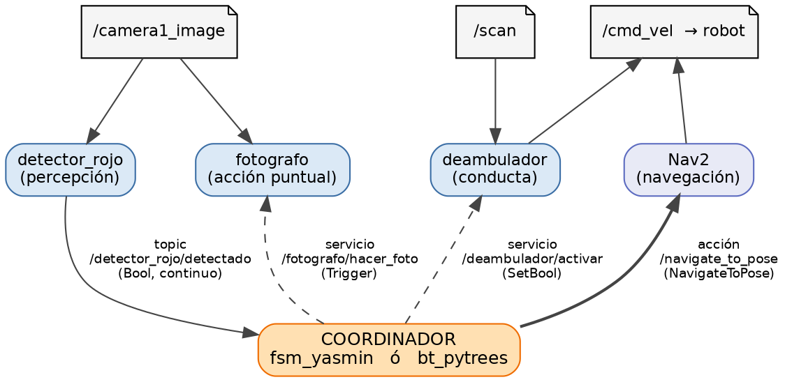
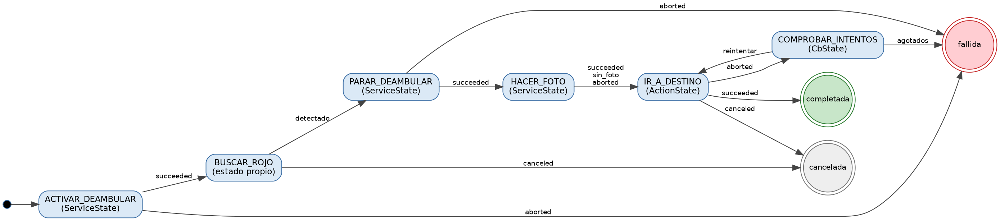
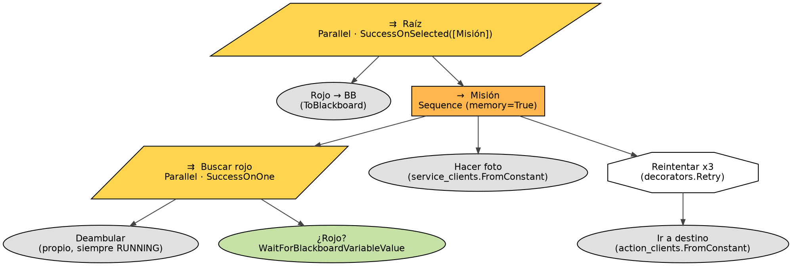

# Programar tareas en ROS 2: varios nodos, FSM y *behavior trees*

**Robots Móviles. Universidad de Alicante. Material de apoyo para el proyecto**

Estos apuntes resuelven paso a paso una tarea sencilla para que tengáis un ejemplo completo y funcionando que pueda servir "de inspiración" para estructurar vuestro proyecto. El código está en el paquete `buscar_rojo` que acompaña a estos apuntes.

**La tarea:** el robot deambula al azar evitando obstáculos hasta que ve un objeto rojo. Entonces le hace una foto y navega a un punto (x, y) del mapa.

Vamos a ver cuatro cosas:

1. Cómo repartir la tarea en **varios nodos** que trabajan en paralelo.
2. Cómo **navegar a un punto del mapa desde código** (no desde rviz2).
3. Cómo coordinar los nodos con una **máquina de estados** (YASMIN).
4. Cómo coordinarlos con un ***behavior tree*** (py_trees_ros).


Se incluye un paquete ROS con código de ejemplo. Las instrucciones de instalación y uso están en el apéndice.

---

## 1. Repartir la tarea en varios nodos

### 1.1. Por qué no hacerlo todo en un nodo

La tentación es escribir un único nodo que se suscribe a la cámara y al láser, procesa la imagen, mueve el robot, guarda la foto y llama a Nav2. Funciona para tareas pequeñas, pero en cuanto la tarea crece aparecen los problemas:

- **No hay paralelismo real.** En un nodo Python los *callbacks* se ejecutan de uno en uno. Si procesar una imagen tarda 100 ms, durante esos 100 ms el robot no reacciona al láser.
- **No se puede probar por partes.** Para saber si el detector de rojo funciona tenéis que ejecutar la tarea entera.
- **No se puede reutilizar.** El detector de rojo de este proyecto os puede servir en otro, pero no si está mezclado con la lógica de la tarea.
- **Un fallo lo tumba todo.** Una excepción en el procesamiento de imagen para también el control del robot.

La alternativa es la forma habitual de trabajar en ROS. Cada nodo hace **una sola cosa** y la ofrece al resto mediante topics, servicios o acciones. Un nodo **coordinador** decide qué hay que hacer en cada momento.

### 1.2. Topic, servicio o acción

Al diseñar cada nodo, la pregunta clave es cómo se comunica con los demás:

| Mecanismo | Patrón | Úsalo para... | En el ejemplo |
|---|---|---|---|
| **Topic** | Publicar/suscribir, flujo continuo | Datos que cambian todo el rato: sensores, detecciones, estado | `/detector_rojo/detectado` (¿veo rojo ahora?) |
| **Servicio** | Petición → respuesta **rápida** | Órdenes que se cumplen al momento: activar/desactivar, guardar algo, consultar | `/deambulador/activar`, `/fotografo/hacer_foto` |
| **Acción** | *Goal* → *feedback* periódico → resultado | Tareas **largas** que se pueden cancelar: navegar, girar 360°, coger un objeto | `/navigate_to_pose` (Nav2) |

### 1.3. Arquitectura del ejemplo



| Nodo | Tipo | Qué hace | Interfaz |
|---|---|---|---|
| `detector_rojo` | Percepción | Segmenta el rojo en HSV y dice continuamente si lo ve | Publica `/detector_rojo/detectado` (`std_msgs/Bool`) y `/detector_rojo/mascara` (imagen para depurar) |
| `deambulador` | Conducta | Navega al azar evitando obstáculos con el láser, **solo mientras está activado** | Servicio `/deambulador/activar` (`std_srvs/SetBool`) |
| `fotografo` | Acción puntual | Guarda en disco la última imagen de la cámara | Servicio `/fotografo/hacer_foto` (`std_srvs/Trigger`) |
| Nav2 | Navegación | Planifica y sigue la ruta a un punto del mapa | Acción `/navigate_to_pose` |
| Coordinador | Coordinación | Decide qué hacer y cuándo. **No** procesa sensores ni mueve el robot directamente | `fsm_yasmin` **o** `bt_pytrees` |

Hay tres decisiones de diseño en las que conviene fijarse:

**El detector publica siempre, también `False`.** Es tentador publicar solo cuando se ve el color, pero entonces quien escucha no puede distinguir entre "no hay rojo" y "el detector no funciona", y además puede recibir un mensaje antiguo. Publicando el estado en cada imagen, el coordinador siempre sabe qué está pasando. El detector también exige ver rojo en varias imágenes seguidas (parámetro `frames_confirmacion`) para filtrar falsos positivos.

**El deambulador se activa y desactiva.** Nav2 también publica en `/cmd_vel`. Si dos nodos publican a la vez en `/cmd_vel`, el robot recibe órdenes contradictorias y hace cosas raras. Por eso, cuando el deambulador está desactivado, no publica nada. El bucle de control (10 Hz, con un *timer*) vive dentro del deambulador. El coordinador solo decide **cuándo** deambular, no **cómo**.

**Los parámetros van fuera del código.** Umbrales, velocidades y carpetas son parámetros ROS, así que podéis ajustarlos sin tocar código:

```bash
ros2 run buscar_rojo detector_rojo --ros-args -p umbral_pixeles:=1000
```

### 1.4. Cada nodo se prueba por separado

Esta es la gran ventaja de este diseño. Antes de escribir ninguna FSM podéis comprobar cada pieza a mano:

```bash
# ¿El detector ve el objeto?
ros2 run buscar_rojo detector_rojo
ros2 topic echo /detector_rojo/detectado
ros2 run rqt_image_view rqt_image_view /detector_rojo/mascara

# ¿El deambulador esquiva bien?
ros2 run buscar_rojo deambulador
ros2 service call /deambulador/activar std_srvs/srv/SetBool "{data: true}"
ros2 service call /deambulador/activar std_srvs/srv/SetBool "{data: false}"

# ¿El fotógrafo guarda la foto?
ros2 run buscar_rojo fotografo
ros2 service call /fotografo/hacer_foto std_srvs/srv/Trigger
```

Para lanzar los tres a la vez está el *launch file* `capacidades.launch.py`:

```bash
ros2 launch buscar_rojo capacidades.launch.py
```

### 1.5. Errores típicos

- **Bucles largos o `time.sleep()` dentro de un *callback*.** Mientras el *callback* no termina, el nodo no procesa nada más. Si algo tiene que repetirse, usad un *timer* (`create_timer`).
- **Dos nodos publicando en `/cmd_vel` a la vez** (ved arriba).
- **`cv2.imshow` dentro de un nodo.** En el robot real puede no haber pantalla. Publicad la imagen de depuración en un topic y miradla con `rqt_image_view`.
- **Nombres de topic escritos a mano en varios sitios.** En el ejemplo están todos en [`comun.py`](https://github.com/ottocol/buscar_rojo/tree/main/buscar_rojo/comun.py). Una errata en un nombre no da ningún error: simplemente nunca llega nada.

---

## 2. Navegar a un punto del mapa desde código

Cuando en rviz2 pulsáis *Nav2 Goal*, rviz2 envía un *goal* a la **acción** `/navigate_to_pose` de Nav2, de tipo `nav2_msgs/action/NavigateToPose`. Desde código se hace exactamente lo mismo. Incluso se puede probar desde la terminal:

```bash
ros2 action send_goal /navigate_to_pose nav2_msgs/action/NavigateToPose \
  "{pose: {header: {frame_id: map}, pose: {position: {x: -10.0, y: -9.0}, orientation: {w: 1.0}}}}" --feedback
```

Desde Python lo más cómodo es **`nav2_simple_commander`** (paquete `ros-jazzy-nav2-simple-commander`), que envuelve la acción en llamadas sencillas. Este es el núcleo de [`ir_a_punto.py`](https://github.com/ottocol/buscar_rojo/tree/main/buscar_rojo/ir_a_punto.py):

```python
from nav2_simple_commander.robot_navigator import BasicNavigator, TaskResult

nav = BasicNavigator()
destino = crear_pose(x, y, yaw)      # PoseStamped en el frame 'map'
nav.goToPose(destino)                # envía el goal y vuelve enseguida

while not nav.isTaskComplete():      # mientras tanto se pueden hacer otras cosas
    feedback = nav.getFeedback()
    print(f'Faltan {feedback.distance_remaining:.2f} m')
    # si hiciera falta: nav.cancelTask()

if nav.getResult() == TaskResult.SUCCEEDED:
    print('¡Destino alcanzado!')
```

Cosas a tener en cuenta:

- **La pose va en el frame `map`**, y la orientación es un cuaternio. Para un giro `yaw` en el plano es `(0, 0, sin(yaw/2), cos(yaw/2))`. Lo calcula la función `crear_pose` de `comun.py`.
- **El robot tiene que estar localizado** antes de navegar. En vez de usar *2D Pose Estimate* en rviz2, podéis hacerlo también por código con [`pose_inicial.py`](https://github.com/ottocol/buscar_rojo/tree/main/buscar_rojo/pose_inicial.py), que usa `nav.setInitialPose(pose)` y `nav.waitUntilNav2Active()`.
- **`goToPose` no bloquea.** Si queréis que el robot haga algo mientras navega, ese es el sitio.
- Dentro de la FSM y del *behavior tree* **no** usaremos `BasicNavigator`. Tanto YASMIN como py_trees_ros traen su propio cliente de acciones, así que usaremos esos.

```bash
ros2 run buscar_rojo pose_inicial      # por defecto (-10, 10, -90º), donde empieza el robot en el mundo del ejemplo
ros2 run buscar_rojo ir_a_punto --ros-args -p x:=-10.0 -p y:=-9.0
```

---

## 3. Coordinar con una máquina de estados (YASMIN)

### 3.1. La máquina



Código completo: [`fsm_yasmin.py`](https://github.com/ottocol/buscar_rojo/tree/main/buscar_rojo/fsm_yasmin.py).

Fijaos en que **ningún estado mueve el robot ni procesa imágenes**. Los estados solo hacen tres tipos de cosas, y YASMIN tiene clases ya hechas para casi todas:

| Necesito... | Clase YASMIN | Estados del ejemplo |
|---|---|---|
| Llamar a un servicio | `ServiceState` | `ACTIVAR_DEAMBULAR`, `PARAR_DEAMBULAR`, `HACER_FOTO` |
| Lanzar una acción y esperar su resultado | `ActionState` | `IR_A_DESTINO` |
| Esperar un evento | Estado propio (`State`) | `BUSCAR_ROJO` |
| Hacer un cálculo rápido o tomar una decisión | `CbState` (una función) | `COMPROBAR_INTENTOS` |

El paralelismo no está en la FSM. Lo dan los nodos: mientras la máquina está en `BUSCAR_ROJO`, el deambulador mueve el robot y el detector procesa imágenes, cada uno en su propio proceso.

### 3.2. Los estados

**Llamar a un servicio.** Basta con decir el tipo, el nombre y una función que construya la petición:

```python
class ActivarDeambular(ServiceState):
    def __init__(self, activar: bool):
        self.activar = activar
        super().__init__(SetBool, '/deambulador/activar', self.crear_peticion)

    def crear_peticion(self, blackboard):
        return SetBool.Request(data=self.activar)
```

Los *outcomes* posibles son los de YASMIN: `succeeded` y `aborted`. Si queréis decidir el *outcome* según la respuesta, añadid un `response_handler`. Es lo que hace `HacerFoto`, que devuelve `sin_foto` si el fotógrafo no pudo guardarla y apunta la ruta de la foto en el *blackboard*.

**Lanzar una acción (Nav2).** Se indica el tipo y el nombre de la acción y una función que construye el *goal*. Aquí el destino se lee del *blackboard*:

```python
class IrADestino(ActionState):
    def __init__(self):
        super().__init__(NavigateToPose, '/navigate_to_pose', self.crear_goal,
                         feedback_handler=self.feedback)

    def crear_goal(self, blackboard):
        x, y = blackboard['destino']
        goal = NavigateToPose.Goal()
        goal.pose = crear_pose(x, y)
        return goal
```

**Esperar un evento.** Para "esperar hasta ver rojo" escribimos un estado propio. No hace falta ningún bucle con `spin_once`: YASMIN tiene un nodo propio (`YasminNode`) que procesa los *callbacks* en otro hilo. El estado solo espera a que el *callback* levante una bandera (un `threading.Event`):

```python
class EsperarRojo(State):
    def __init__(self):
        super().__init__([DETECTADO, CANCEL])
        self.nodo = YasminNode.get_instance()
        self.rojo_visto = Event()

    def execute(self, blackboard):
        self.rojo_visto.clear()
        sub = self.nodo.create_subscription(Bool, '/detector_rojo/detectado',
                                            self.detector_cb, 10)
        try:
            self.rojo_visto.wait()          # bloquea el estado, no el nodo
        finally:
            self.nodo.destroy_subscription(sub)
        return CANCEL if self.is_canceled() else DETECTADO

    def detector_cb(self, msg):
        if msg.data:
            self.rojo_visto.set()

    def cancel_state(self):
        self.rojo_visto.set()               # para poder salir con Ctrl-C
        super().cancel_state()
```

> YASMIN también trae `MonitorState` para escuchar topics, pero procesa **un mensaje por ejecución** y guarda los mensajes que llegan aunque el estado no esté activo. Para "esperar a que algo sea cierto" resulta más claro el estado propio.

### 3.3. Montar la máquina

```python
sm = StateMachine(outcomes=['completada', 'fallida', 'cancelada'], handle_sigint=True)
sm.add_state('ACTIVAR_DEAMBULAR', ActivarDeambular(True),
             transitions={'succeeded': 'BUSCAR_ROJO', 'aborted': 'fallida'})
sm.add_state('BUSCAR_ROJO', EsperarRojo(),
             transitions={'detectado': 'PARAR_DEAMBULAR', 'canceled': 'cancelada'})
# ... resto de estados ...
sm.add_state('COMPROBAR_INTENTOS', CbState(['reintentar', 'agotados'], comprobar_intentos),
             transitions={'reintentar': 'IR_A_DESTINO', 'agotados': 'fallida'})
sm.validate()

blackboard = Blackboard()
blackboard['destino'] = (destino_x, destino_y)
blackboard['intentos'] = 0
YasminViewerPub(sm, 'BUSCAR_ROJO')    # para verla en el navegador (ver más abajo)
resultado = sm(blackboard)
```

`sm.validate()` comprueba que todos los *outcomes* de todos los estados llevan a algún sitio. Si os falta una transición, os avisa antes de arrancar y no a mitad de la tarea.

### 3.4. Detalles que os ahorrarán tiempo

- **El *blackboard* se usa como un diccionario:** `blackboard['clave']`.
- **Ctrl-C.** Con `handle_sigint=True`, al pulsar Ctrl-C YASMIN cancela el estado activo (por ejemplo, el *goal* de Nav2) y la llamada `sm(blackboard)` termina lanzando una excepción. Pero ojo: si paráis la FSM mientras el robot deambula, el **deambulador es otro nodo** y seguiría moviendo el robot. Por eso el ejemplo, al salir, siempre le pide que pare (función `parar_deambulador`).
- **Visualizar la máquina:** `ros2 run yasmin_viewer yasmin_viewer_node` y abrid `http://localhost:5000` en el navegador. Veréis el estado activo en tiempo real.

---

## 4. Coordinar con un *behavior tree* (py_trees_ros)

### 4.1. Lo mínimo que hay que saber

Un *behavior tree* (BT) se **ejecuta por *ticks***. Varias veces por segundo (10 en el ejemplo) se recorre el árbol desde la raíz. Cada nodo devuelve uno de tres estados: `SUCCESS`, `FAILURE` o `RUNNING` ("sigo en ello").

- **Hojas** (*behaviours*): hacen algo o comprueban algo. Ejemplos: llamar a un servicio, enviar un *goal* a Nav2, comprobar una variable.
- **Compuestos**, que deciden cómo se ejecutan sus hijos:
  - **Sequence** (→): ejecuta los hijos en orden y falla si falla uno. Es el "y luego".
  - **Selector**, o *fallback* (?): prueba los hijos en orden hasta que uno tenga éxito. Es el "si no, prueba esto".
  - **Parallel** (⇉): ejecuta todos los hijos en cada *tick*. Una **política** decide cuándo ha terminado.
- **Decoradores**: modifican a un único hijo, por ejemplo reintentar si falla (`Retry`) o invertir el resultado (`Inverter`).
- ***Blackboard***: variables compartidas por todo el árbol, como en YASMIN.

### 4.2. El árbol



Código completo: [`bt_pytrees.py`](https://github.com/ottocol/buscar_rojo/tree/main/buscar_rojo/bt_pytrees.py).

Se lee así. La **Raíz** ejecuta en paralelo dos cosas: copiar los datos del detector al *blackboard* y la **Misión**. La Misión es una secuencia de tres pasos:

1. **Buscar rojo**: deambular **en paralelo** con "¿veo rojo?". Termina en cuanto **uno** de los dos tenga éxito (`SuccessOnOne`). Deambular nunca termina por sí solo, así que el paso acaba cuando aparece el rojo.
2. **Hacer foto.**
3. **Ir a destino**, con hasta 3 intentos.

### 4.3. El código

Casi todo son *behaviours* que ya trae py_trees_ros. Las comparaciones son con el operador `operator.eq`:

```python
# topic → blackboard: en cada tick copia msg.data a la variable 'rojo_detectado'
rojo_a_bb = py_trees_ros.subscribers.ToBlackboard(
    name='Rojo → BB', topic_name='/detector_rojo/detectado', topic_type=Bool,
    qos_profile=py_trees_ros.utilities.qos_profile_unlatched(),
    blackboard_variables={'rojo_detectado': 'data'},
    initialise_variables={'rojo_detectado': False},
    clearing_policy=py_trees.common.ClearingPolicy.NEVER)

# condición: RUNNING hasta que rojo_detectado == True
hay_rojo = py_trees.behaviours.WaitForBlackboardVariableValue(
    name='¿Rojo?',
    check=py_trees.common.ComparisonExpression('rojo_detectado', True, operator.eq))

buscar = py_trees.composites.Parallel(
    'Buscar rojo', policy=py_trees.common.ParallelPolicy.SuccessOnOne(),
    children=[Deambular(), hay_rojo])

hacer_foto = py_trees_ros.service_clients.FromConstant(
    name='Hacer foto', service_type=Trigger, service_name='/fotografo/hacer_foto',
    service_request=Trigger.Request(), key_response='respuesta_foto')

ir_a_destino = py_trees_ros.action_clients.FromConstant(
    name='Ir a destino', action_type=NavigateToPose, action_name='/navigate_to_pose',
    action_goal=goal)
reintentar = py_trees.decorators.Retry('Reintentar x3', ir_a_destino, num_failures=3)

mision = py_trees.composites.Sequence('Misión', memory=True,
                                      children=[buscar, hacer_foto, reintentar])
raiz = py_trees.composites.Parallel(
    'Raíz',
    policy=py_trees.common.ParallelPolicy.SuccessOnSelected([mision], synchronise=False),
    children=[rojo_a_bb, mision])
```

El único *behaviour* propio es **Deambular**. Muestra el ciclo de vida de un nodo de py_trees, que es lo que hay que entender para escribir los vuestros:

```python
class Deambular(py_trees.behaviour.Behaviour):
    def setup(self, **kwargs):           # una vez, al arrancar el árbol
        self.cliente = kwargs['node'].create_client(SetBool, '/deambulador/activar')

    def initialise(self):                # cada vez que empieza a ejecutarse
        self.futuro = self.cliente.call_async(SetBool.Request(data=True))

    def update(self):                    # en cada tick
        return py_trees.common.Status.RUNNING

    def terminate(self, new_status):     # al acabar o al ser interrumpido
        self.cliente.call_async(SetBool.Request(data=False))
```

Cuando `¿Rojo?` tiene éxito, el Parallel "Buscar rojo" termina e **interrumpe** a Deambular. py_trees llama entonces a su `terminate()`, que apaga el deambulador. En la FSM hicieron falta dos estados (activar y parar). Aquí el apagado va "pegado" al comportamiento y no se puede olvidar.

Y para ejecutarlo:

```python
arbol = py_trees_ros.trees.BehaviourTree(raiz)
arbol.setup(node=nodo, timeout=15.0)   # espera a que existan servicios y acciones
arbol.tick_tock(period_ms=100)         # 10 ticks por segundo
while rclpy.ok() and arbol.root.status not in (Status.SUCCESS, Status.FAILURE):
    rclpy.spin_once(nodo, timeout_sec=0.1)
```

### 4.4. Detalles que os ahorrarán tiempo

- **`memory=True` en la Sequence.** Un hijo que ya tuvo éxito no se vuelve a ejecutar en los *ticks* siguientes. Con `memory=False` se reevalúa desde el primer hijo en cada *tick*. Es útil cuando los primeros hijos son **condiciones** que deben seguir cumpliéndose, por ejemplo "¿batería OK?".
- **`synchronise=False` en el Parallel raíz.** Con `True`, que es el valor por defecto, un hijo que ya tuvo éxito deja de ejecutarse. `Rojo → BB` dejaría entonces de actualizar el *blackboard* después del primer mensaje.
- **Ctrl-C:** `arbol.root.stop(Status.INVALID)` llama al `terminate()` de todo lo que esté en marcha. Así se apaga el deambulador y se cancela el *goal* de Nav2. Ojo, que `arbol.interrupt()` **no** lo hace: solo detiene los *ticks*.
- **Ver el árbol en vivo:** el ejemplo lo imprime en consola cada vez que cambia algún estado. También podéis usar `ros2 run py_trees_ros py-trees-tree-watcher` en otra terminal.

### 4.5. ¿Y el Selector?

Este árbol no lo necesita, pero aparece en cuanto la tarea tiene alternativas o recuperación de errores. Por ejemplo, "si ya he visto rojo, no busques":

```python
buscar_si_hace_falta = py_trees.composites.Selector('¿Hace falta buscar?', memory=False, children=[
    py_trees.behaviours.CheckBlackboardVariableValue(          # SUCCESS si ya lo veo
        '¿Ya veo rojo?',
        check=py_trees.common.ComparisonExpression('rojo_detectado', True, operator.eq)),
    buscar,                                                     # si no, a buscar
])
```

---

## 5. ¿FSM o *behavior tree*?

| | FSM (YASMIN) | *Behavior tree* (py_trees_ros) |
|---|---|---|
| Idea | El robot **está en** un estado y salta a otro según el resultado | En cada *tick* se **reevalúa** qué hacer recorriendo el árbol |
| Fácil de... | Entender y dibujar si hay pocos estados | Ampliar: añadir una rama no obliga a revisar todas las transiciones |
| Paralelismo dentro del coordinador | Incómodo (la clase `Concurrence` espera a que acaben **todos**) | Natural (`Parallel` con políticas) |
| Reaccionar a algo en cualquier momento (batería baja, obstáculo...) | Hay que añadir la transición en **cada** estado | Una condición cerca de la raíz lo cubre todo |
| Limpieza al interrumpir | Manual (estados extra, como `PARAR_DEAMBULAR`) | En el `terminate()` de cada *behaviour* |
| Lo conocéis de... | Otras asignaturas | Robótica y videojuegos (Nav2 usa BTs por dentro) |

Como regla práctica: si la tarea es una **secuencia** con alguna bifurcación, una FSM es más directa. Si hay que **reaccionar** a varias cosas a la vez, o la tarea va a ir creciendo, un BT escala mejor. En los dos casos, lo que de verdad simplifica el coordinador es haber repartido el trabajo en nodos.

---

## Apéndice: Poner el código de ejemplo en marcha

### Instalación

```bash
# dependencias (además de mvsim y Nav2)
sudo apt install ros-jazzy-nav2-simple-commander ros-jazzy-py-trees-ros ros-jazzy-cv-bridge
sudo apt install ros-jazzy-yasmin ros-jazzy-yasmin-ros ros-jazzy-yasmin-viewer

# en la carpeta src/ de vuestro workspace: copiad el paquete buscar_rojo y compilad
cd VUESTRO_WORKSPACE_DE_ROS2/src
git clone https://github.com/ottocol/buscar_rojo
colcon build --symlink-install --packages-select buscar_rojo
source install/setup.bash
```

> **Versiones.** El ejemplo está probado con **YASMIN 6.1.2** y **py_trees / py_trees_ros 2.6.0**, las versiones que instala `apt` en jazzy. YASMIN cambia bastante entre versiones grandes: si encontráis ejemplos en Internet para YASMIN 3.x, algunas cosas no coinciden (por ejemplo, el orden de los parámetros de `YasminViewerPub`).

### El mundo

El paquete incluye el mundo para mvsim `world/buscar_rojo.world.xml` y su mapa ya construido (`world/mapa.yaml`). Es una sala de 30 × 30 m con algunas paredes interiores y tres papeleras. El robot empieza en (-10, 10) mirando hacia abajo (-90º) y hay una **caja roja** en (-13, 8). Para moverla, cambiad su `<init_pose>`. Ninguna otra cosa del mundo es roja, para no confundir al detector.

### Terminales

```bash
# Lo más sencillo, usar este launch que está en la carpeta /world del paquete
## IR A LA CARPETA world y ejecutar esto. Se debería poner en marcha el simulador y la navegación
ros2 launch buscar_rojo preparar_sim.launch.py

# 4. Los nodos "capacidad": detector, deambulador y fotógrafo
ros2 launch buscar_rojo capacidades.launch.py

# 5. UN coordinador (la FSM o el BT, no los dos a la vez)
ros2 run buscar_rojo fsm_yasmin --ros-args -p destino_x:=-10.0 -p destino_y:=-9.0
ros2 run buscar_rojo bt_pytrees --ros-args -p destino_x:=-10.0 -p destino_y:=-9.0
```


Como ALTERNATIVA a `preparar_sim.launch.py` tenéis los pasos por separado, por si os son útiles (NO HAGÁIS LAS DOS COSAS):

```bash
# 1. Simulador
#ANTES ir a la carpeta /world del paquete buscar_rojo
ros2 launch mvsim launch_world.launch.py world_file:=./buscar_rojo.world.xml do_fake_localization:=false disable_sim_time_clock:=true

# 2. Nav2 con el mapa del mundo
#ANTES ir a la carpeta /world del paquete buscar_rojo
ros2 launch nav2_bringup bringup_launch.py map:=./mapa.yaml params_file:=./nav2.yaml

# En las siguientes terminales hay que haber hecho source install/setup.bash del workspace

# 3. Pose inicial por código. Fija la pose que tiene en el mundo por defecto, pero se le pueden pasar parámetros x e y 
# También se podría hacer manualmente clicando en rviz2 con 2D Pose Estimate en rviz2
ros2 run buscar_rojo pose_inicial
```

Las fotos se guardan en `~/fotos_robot`.


Estructura del paquete:

```
buscar_rojo/
├── buscar_rojo/
│   ├── comun.py            nombres de topics/servicios y crear_pose()
│   ├── detector_rojo.py    nodo de percepción
│   ├── deambulador.py      nodo de conducta (activable por servicio)
│   ├── fotografo.py        nodo de acción puntual (servicio)
│   ├── pose_inicial.py     fijar la pose inicial con nav2_simple_commander
│   ├── ir_a_punto.py       navegar a (x, y) con nav2_simple_commander
│   ├── fsm_yasmin.py       coordinador con máquina de estados
│   └── bt_pytrees.py       coordinador con behavior tree
├── launch/capacidades.launch.py
└── world/                  mundo mvsim con la caja roja y su mapa
```
